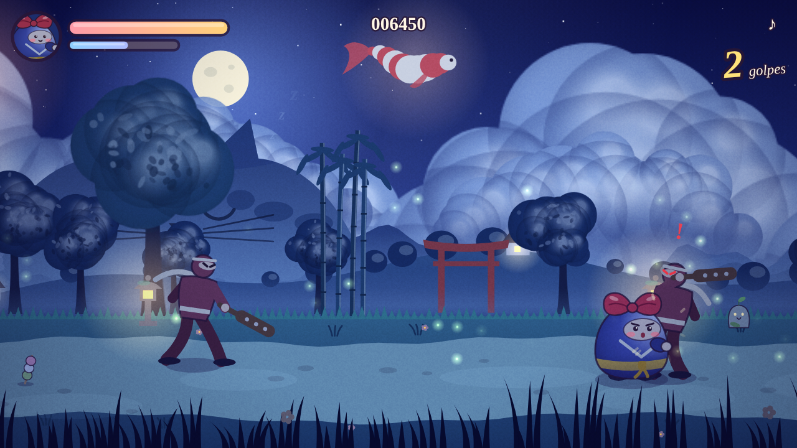
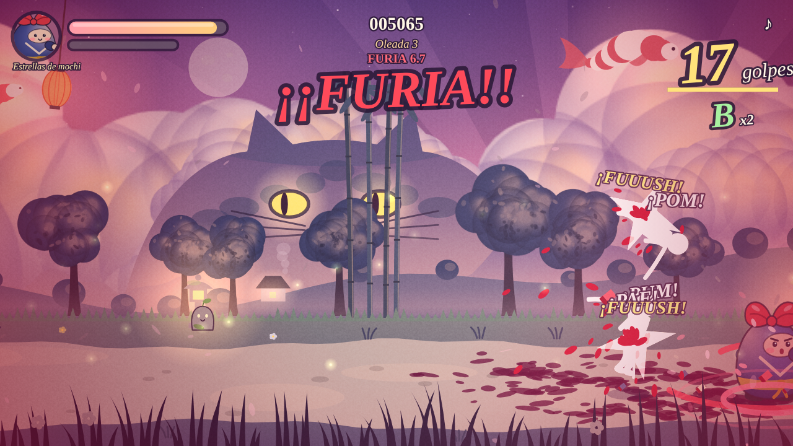

# Mochi Fable

La fábula 2.5D de un ninja redondo con un gran lazo rojo que casi no salta.
Beat 'em up de carril con profundidad, pintado y musicado por código: sin assets, sin dependencias.

## Jugar
- **Sin servidor:** abre `dist/index.html` (un único fichero autocontenido).
- **En desarrollo:** `npm start` y visita <http://localhost:8080>.

| Acción | Teclado | Táctil |
| --- | --- | --- |
| Mover por el camino | ← ↑ ↓ → / WASD | Palanca izquierda |
| Golpe (x3 = barrigazo) | Z / J | GOLPE |
| Saltito (+ golpe = planchazo) | X / K | SALTO |
| Rodar (esquiva y atropella) | C / L / Mayús | RODAR |
| Tifón de Lazo (medidor lleno) | Espacio / V | ✿ |
| Pausa / sonido | P / N | icono ♪ |

Golpea los shuriken para devolverlos. Hay **8 secretos**; la pantalla final da una pista.

## Lo que engancha
- **Sangre y trozos:** cada golpe salpica, las bajas revientan y las manchas se quedan en el camino.
- **Combos con rango** (C, B, A, S, SS, MOCHI) que multiplican la puntuación, y **Furia** a los 15 golpes seguidos.
- **Malabares:** remata enemigos en el aire, estréllalos contra el borde o úsalos de bolos contra los demás.
- **Ninjas-bomba:** explotan junto a ti... o junto a sus compañeros si los lanzas a tiempo.
- **Mejoras:** tras cada combate eliges 1 de 3 (vampirismo, onda sísmica, shuriken propios...).
- **Reto sin fin** (tecla R): oleadas cada vez más duras, jefe cada 5 y récords guardados.

## Estructura
- `src/core.js`: lógica pura (física, alcance, oleadas, códigos secretos, paleta). Tests en `tests/`.
- `src/world.js`: cielo, 12 capas de parallax, rayos de luz, farolillos, luciérnagas, etalonaje.
- `src/actors.js`: Mochi, ninjas y jefe animados proceduralmente.
- `src/audio.js`: vals original en 3/4 y efectos con WebAudio.
- `src/main.js`: bucle, entrada, combate, IA, HUD.
- `openspec/`: spec del cambio (método ANVIL). `docs/RUN_REPORT.md`: evidencia de la ejecución.

`npm test` ejecuta los tests; `npm run build` regenera `dist/`.
